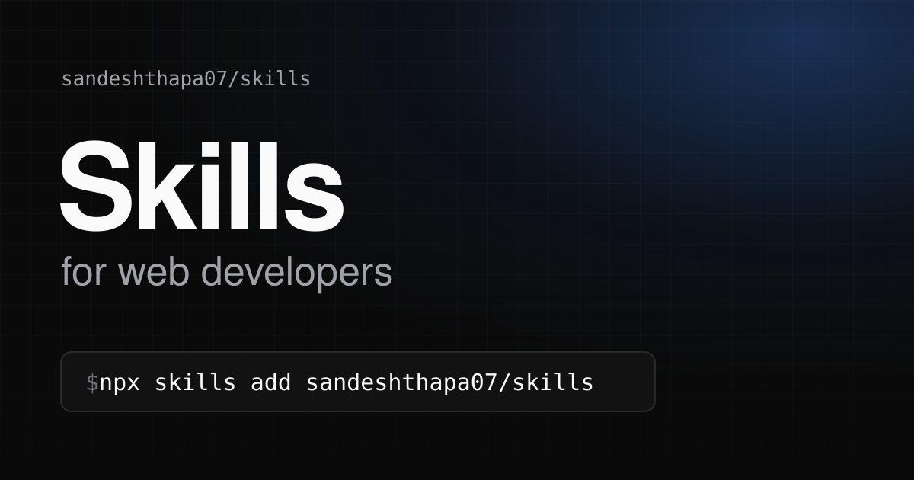

# Skills for Web Developers

[](#install)
[](LICENSE)

Agent skills that teach AI coding agents the details they usually get wrong.

An agent can write a page that works. But small details decide whether the page is fast, stable and accessible, and agents miss those details all the time. You only notice later: in Lighthouse, on a slow phone, or when a shared link shows no preview.

Each skill here covers one area. It lists the mistakes that agents make, explains why each one is a mistake, and gives the fix for every major framework. Some skills also include scripts that check the result.

Your agent loads a skill automatically when a task matches it, so you do not have to repeat the rules in every prompt. The skills work with Claude Code, Cursor, Codex, GitHub Copilot, Gemini CLI, OpenCode and other agents that support the Agent Skills format.

## Install

```bash
npx skills@latest add sandeshthapa07/skills
```

The CLI asks which skills to install. Type to **search** by name, press `Space` on **Select All** to take every skill, then press `Enter`.

<details>
<summary>More install options</summary>

### The skill picker

```
◆  Select skills to install
│  Search: ▌
│  ↑↓ move, space select, enter confirm
│
│ ❯ ○ Select All (0/2)
│   ────────────────────────────────────
│   ○ image-optimization
│   ○ your-next-skill
│
│  Description
│  Select or clear all 2 skills.
└
```

| Key | Action |
|---|---|
| Type letters | Filter the list by skill name. |
| `Backspace` | Delete the last search letter. |
| `↑` / `↓` | Move the cursor. |
| `Space` | Select or clear the skill under the cursor. On **Select All**, select every skill (press it again to clear all). |
| `Enter` | Confirm and continue. |
| `Esc` | Cancel. |

- The skill picker appears only when the repository has two or more skills. While there is one skill, the CLI installs that skill without asking.
- **Select All** selects every skill in the repository, including skills that the current search hides.
- Next, the CLI asks for the agents to install to (this list also has a search box), and for project or global scope.

### Without prompts

```bash
# Show every skill in the repository, install nothing
npx skills@latest add sandeshthapa07/skills --list

# One skill, or several skills by name
npx skills@latest add sandeshthapa07/skills --skill image-optimization
npx skills@latest add sandeshthapa07/skills --skill image-optimization --skill another-skill

# All skills (the CLI still asks for the agents)
npx skills@latest add sandeshthapa07/skills --skill '*'

# All skills, all agents, no prompts
npx skills@latest add sandeshthapa07/skills --all

# Specific agents, and global (user level) instead of the current project
npx skills@latest add sandeshthapa07/skills -a claude-code -a cursor -g
```

### Manage installed skills

```bash
npx skills list                        # installed skills
npx skills update image-optimization   # get the latest version
npx skills remove image-optimization   # uninstall
npx skills find image                  # search the public skills.sh directory
```

- A project install puts each skill in `.agents/skills/<skill>/` and links it into each agent's folder (for example `.claude/skills/<skill>`). Use `--copy` to copy the files instead of creating links.
- Review a skill before you install it: skills run with your agent's permissions.
- For other install methods (git clone, manual copy, adapters for tools without Agent Skills support), see the README in each skill's folder.

</details>

## Why use it?

Agents do not know which image is the important one.

They put `loading="lazy"` on the hero image, so the largest image on the page loads last. They add `fetchpriority="high"` to every image, so no image gets priority. They write a `srcset` without `sizes`, so the browser assumes that the image fills the screen and downloads a file that is too large. They leave out `width` and `height`, so the layout jumps when the image arrives. They put an image in a fixed box without `object-fit`, so it stretches. They set an `og:image` with the wrong size, so a shared link shows a cropped preview or none.

Each mistake is small. Together, they decide whether a page feels fast or broken.

These skills give your agent the rules that it is missing, so it gets the details right the first time.

## Reference

- **[image-optimization](./skills/image-optimization/)** `v1.0.0` — Fix images that stretch, look blurry, load slowly or shift the layout, in any framework. It gives every image a role (LCP, above the fold, below the fold, background) and applies the right `srcset`, `sizes`, `loading` and `fetchpriority` for that role. Also covers AVIF/WebP, alt text and social share images (`og:image`, X cards), with audit scripts that check the result.

## Cheatsheets

Quick fixes, one line each:

- **[Cheatsheet](./cheatsheet.md)** — Stretched, blurry or broken images, alt text and link previews.
- **[Performance Cheatsheet](./performance.md)** — Slow LCP, layout shift, oversized downloads, formats and caching.

## Contributing

To add a skill or release a new version of a skill, see [CONTRIBUTING.md](CONTRIBUTING.md).

## License

MIT. See [LICENSE](LICENSE).
